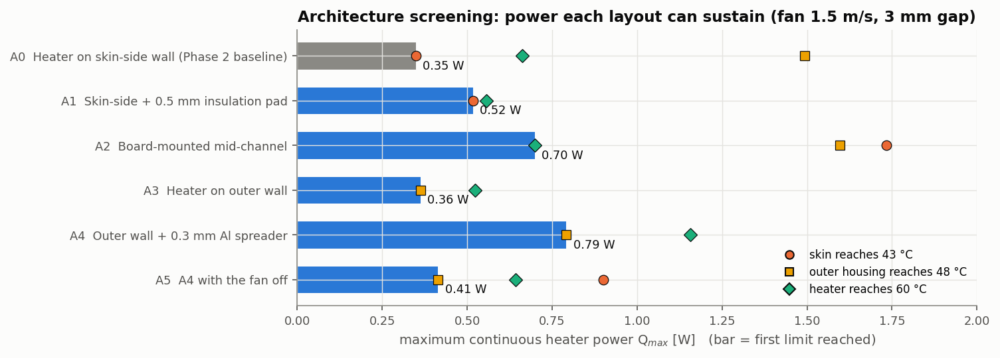
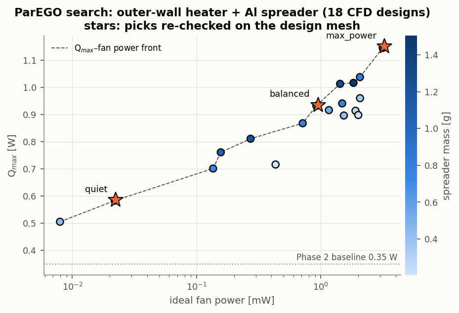

# Phase 4: Redesigning the thermal architecture

`python scripts/phase4_architecture.py screen opt verify report` reproduces everything on this page, in about 3 hours on 2 cores. Numbers are in `results/phase4/` and figures in `docs/figures/phase4_*`.

Phase 2 showed that with the heater on the skin-side wall, no fan setting keeps the skin below 43 °C at 0.5 W. Phase 4 therefore changes the *layout* rather than the fan. It then optimises the best layout.

## Figure of merit: maximum sustainable power

Every design is scored by **Qmax**, the largest continuous heater power it can dissipate while **all three** limits hold:

| Surface | Limit | Basis |
|---|---|---|
| Skin (under and around the device) | 43 °C | long-duration comfort (> 8 h contact) |
| Outer housing (where fingers hold the arm) | 48 °C | IEC 62368-1, contact of 1 min–8 h ([Electronics Cooling 2025](https://www.electronics-cooling.com/2025/07/thermal-design-for-externally-worn-wearable-electronics/)) |
| Heater (battery / SoC stand-in) | 60 °C | typical Li-ion discharge limit from cell datasheets (assumed) |

The model is linear in heater power except for radiation. Qmax therefore comes from **two** CFD runs per design, one idle and one at 0.5 W. The two solutions are superposed face by face as T(x; Q) = Tidle(x) + Q·r(x), and the first face to reach its limit sets Qmax (`coolchan.device3d.max_power`). A third run *at* Qmax checks each chosen design. In every case the binding surface came out 0.05–0.15 K **below** its limit, so the superposition is slightly conservative.

## Step 1: Architecture screening

All six layouts use the Phase 2 design mesh (about 190 k cells), a 1.5 m/s fan and a 3 mm gap.

| Architecture | Qmax [W] | Limited by | Q at skin 43 °C | Q at touch 48 °C | Q at component 60 °C | Fan [mW] |
|---|---|---|---|---|---|---|
| A0: Heater on skin-side wall (Phase 2 baseline) | **0.35** | skin | 0.35 | 1.49 | 0.66 | 0.31 |
| A1: Skin-side + 0.5 mm insulation pad | **0.52** | skin | 0.52 | 2.47 | 0.56 | 0.46 |
| A2: Board-mounted mid-channel | **0.70** | component | 1.73 | 1.60 | 0.70 | 0.54 |
| A3: Heater on outer wall | **0.36** | touch | 5.94 | 0.36 | 0.52 | 0.31 |
| A4: Outer wall + 0.3 mm Al spreader | **0.79** | touch | 3.43 | 0.79 | 1.16 | 0.34 |
| A5: A4 with the fan off | **0.41** | touch | 0.90 | 0.41 | 0.64 | 0.00 |

**What the screening shows.** Every layout just moves the bottleneck to a different surface.

* **A1 (insulation pad)** stops heat conducting into the skin, which lifts Qmax by 50 %. The heat now has to leave through the air instead, so the heater is only 7 % below its own limit.
* **A2 (board-mounted mid-channel)** keeps the heat away from both walls. It is limited by the heater itself, because all 0.5 W has to leave a 20 × 8 mm block by convection.
* **A3 (heater on outer wall)** trades a skin problem for a touch problem. The heater puts a hot spot on a small patch of plastic.
* **A4 (outer wall plus a 0.3 mm aluminium spreader)** is the clear winner at **2.3×** the baseline. The spreader lines the whole outer wall, so the entire 60 × 12 mm wall becomes a metal surface that spreads heat along its length and is cooled by the fan air. The skin barely warms: it would not reach its limit until 3.4 W.
* **A5 (A4 with the fan off)** still beats the fan-cooled baseline. Architecture matters more than airflow.

**Modelling notes.**

* **Spreader.** It is meshed as part of the heater solid (aluminium, bonded); the heat source is applied only to the heater block, through a `cellSet`. A first attempt modelled a copper spreader as a separate region, but the steady segregated solver hit a known weakness: two high-conductivity solids sharing an interface converge extremely slowly. The energy balance was still off by 46 % after 4 000 iterations, so that attempt was discarded. With the merged solid, all runs close the energy balance to 0.1 % or better.
* **Fan-off case.** It solves the energy equation only (`frozenFlow`), so the air is pure conduction. Natural convection inside a 3 mm cavity is negligible at these temperature differences.

## Step 2: Multi-objective Bayesian optimisation of A4

Three objectives are traded:

* maximise **Qmax**;
* minimise **fan power**;
* minimise **spreader mass**.

These are traded over three design variables:

| Variable | Range |
|---|---|
| fan velocity U | 0–3 m/s |
| channel gap H | 2.3–4 mm (air gap ≥ 0.5 mm) |
| Al spreader thickness | 0.1–0.8 mm |

The optimiser is **ParEGO** (Knowles 2006). At each iteration it takes a random Tchebycheff weighting of the three objectives, fits a Gaussian process to the weighted score, and chooses the next design by maximising expected improvement. It starts from a 10-point Latin hypercube, then runs 8 ParEGO iterations: 18 designs, 36 CFD runs on the coarse mesh (×0.75 cells).

Three designs are picked from the Pareto set by explicit rules. Each is re-evaluated on the design mesh and then run *at* its Qmax:

| Design | Fan U [m/s] | Gap [mm] | Al spreader [mm] | Spreader mass [g] | Fan [mW] | Qmax coarse → design mesh [W] | Limited by | At Qmax: skin / touch / component [°C] |
|---|---|---|---|---|---|---|---|---|
| max_power | 3.00 | 2.40 | 0.74 | 1.43 | 3.26 | 1.146 → **1.151** | touch | 36.92 / 47.85 / 49.13 |
| quiet | 0.36 | 2.83 | 0.73 | 1.43 | 0.02 | 0.583 → **0.585** | touch | 39.02 / 47.95 / 49.23 |
| balanced | 1.91 | 2.39 | 0.51 | 0.99 | 0.95 | 0.932 → **0.935** | touch | 36.93 / 47.87 / 49.15 |

* The picking rules are:
  * **max_power**: the highest Qmax in the Pareto set;
  * **quiet**: the highest Qmax with fan power ≤ 0.1 mW;
  * **balanced**: the highest Qmax with fan power ≤ 1 mW and spreader mass ≤ 1 g.
* **The coarse search mesh is accurate enough.** Its Qmax agrees with the design mesh to within 0.5 %.
* **All three designs hold every limit at Qmax.** Skin ≤ 39 °C, touch ≤ 47.95 °C, heater ≤ 49.2 °C, and the energy balance closes to 0.1 %.
* **Caveat for max_power.** Its flow residuals stall at about 3 × 10⁻³. At 3 m/s through a 0.66 mm air gap, the flow separating behind the heater probably wants to be unsteady, like the one stalled Stage 3 case (`train_05`). Its surface temperatures are nonetheless stable to 1 mK between the last two iterates.

## Findings

1. **Layout beats airflow.** The balanced design sustains **0.94 W**, **2.7×** the Phase 2 baseline's 0.35 W. It needs less fan power (0.95 mW) than the Phase 2 case at 3 m/s (1.6 mW), which could not even handle 0.5 W. The quiet design (0.36 m/s) still sustains 0.59 W, and even A4 with the fan off beats the baseline.
2. **The limiting surface has moved from the skin to the outer shell.** Every optimised design is limited by the 48 °C touch limit, with the skin 4–6 K below its own limit. Further gains need more outer surface or better spreading into it (fins, a larger shell, a spreader wrapping the side walls), or a use case that allows the shorter-contact touch limits.
3. **Fan power buys Qmax with diminishing returns.** Going from 0.02 to 1 mW adds 0.35 W of capacity, but going from 1 to 3.3 mW adds only 0.22 W.
4. **About 1 W in this arm needs about 1 g of aluminium and about 1 mW of ideal fan power.** Dissipating the 1–3 W from the original brief would need a larger outer surface area.

## Limitations

* **Steady state.** These are continuous-power results; transient duty cycles are not yet modelled (Phase 3).
* **Assumed inputs.** The contact resistance, room-side h and the 60 °C component limit are assumed. The fan is ideal (Δp × flow); a real fan's efficiency and P–Q curve would raise the true power.
* **Idealised hardware.** The board-mounted heater (A2) has no conduction path through its mounts. The spreader is a perfectly bonded, full-length aluminium plate.
* **Coarse-mesh search.** The optimiser ran on the coarse mesh; the three chosen designs were re-checked on the design mesh.
